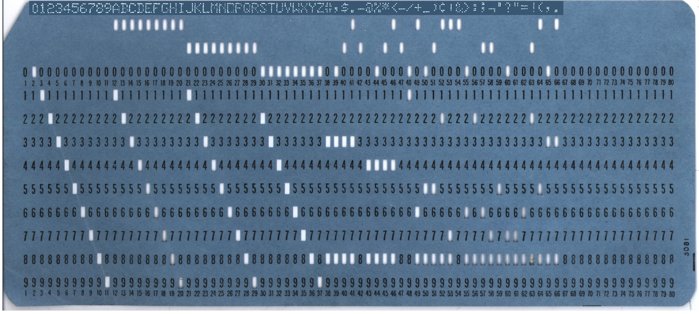
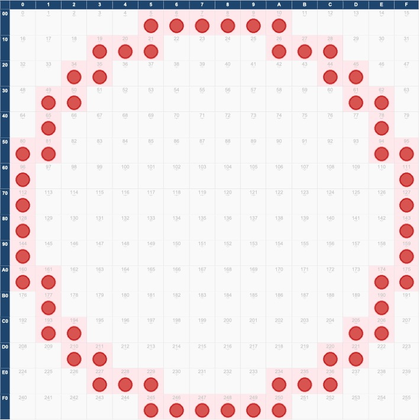

How is reality translated into data? Encoding, the process of converting information from one format into another, lies at the heart of data recording. 

One of the simplest forms of encoding is a physical mark on a surface, such as a notch in wood or a punched hole in paper, used to represent a simple meaning like “yes” or “no”. Similar principles still appear today in tickets, gift cards and punched cards. For example, punched train tickets are a manual system for recording travel information using small holes made in a paper ticket. A hole isn’t random, as it registers something specific, for example the validation of a ticket to prevent reuse by its holder.

The term “digital” originally meant numerical: data expressed through digits (Haigh 2023). Digital does not necessarily mean electronic. Early telegraphy, for example, encoded letters and words through just two types of signal: short and long impulses in [Morse code](https://morsecode.world/international/translator.html).

Early computers followed similar principles. [Punch cards](https://www.si.edu/spotlight/punch-cards/punch-cards-data-processing) stored information through the presence or absence of holes in specific positions. IBM punch cards, widely used from the 1930s onwards, encoded text, numbers and commands using standardised hole patterns. These systems already relied on a central principle of digital data: complex information can be represented through combinations of a limited set of distinct symbols.

<!-- more -->

<!-- briefing-student -->

### 2.a Making sense of encoding with punch cards  | 15 mins  
<!-- section-contents -->
 
Encoding serves to [transform human-readable to machine-readable information](https://en.wikipedia.org/wiki/Character_encoding). Computers can only digest numbers, and more precisely [binary numbers](https://en.wikipedia.org/wiki/Binary_number). In the binary system, [natural numbers](https://en.wikipedia.org/wiki/Natural_number) ([integers](https://en.wikipedia.org/wiki/Integer)) are represented only in `1`s and `0`s. You may have learned to convert decimal numbers into binary in school, but if you’ve forgotten how it works there are many converters and explanations on the web, for example [this converter](https://www.rapidtables.com/convert/number/decimal-to-binary.html).

Let’s look together at how a computer would interpret the holes in punch cards.

STEP 1 
Carefully inspect the image below: it represents an [IBM](https://en.wikipedia.org/wiki/IBM) punch card. The respective holes represent characters (letters, numbers and special characters). Can you distinguish a zone in the card that is readable by humans? Tip: look at the top of the card!

Now think about this question: if you wanted to write your name and make it machine-readable, what knowledge would it take to be able to punch it using this card? (We will come back to this question but for the moment please follow the next step below.)

Caption: An IBM 5081-style punched card showing the encoding of the 1964 EBCDIC Latin character set, including numerals 0-9, upper-case letters A-Z and special characters. The contrast of the human-readable strip at the top of the card has been artificially enhanced. Source: [Wikimedia Commons](https://commons.wikimedia.org/w/index.php?title=File:Blue-punch-card-front-horiz_top-char-contrast-stretched.png&oldid=865403764)

STEP 2 
Now try this great [emulator](https://masswerk.at/keypunch/) built by Austrian artist and web designer Norbert Landsteiner. You can use the SYMBOLIC configuration to type your name with the help of a virtual [typewriter](https://en.wikipedia.org/wiki/Typewriter) and the emulator will punch the card for you.

What is going on here? The emulator has integrated the knowledge that you (very probably) lacked in the previous exercise: an encoding scheme, i.e. the rules to follow to translate characters (or other data) as binary numbers or symbols. A scheme specifies which number represents which character, very much as Morse code did, to obtain a digital (i.e. both numerical and binary) representation of characters and text.

The punch card in the above image and the card you created using the emulator use a scheme created by IBM in 1964: EBCDIC (for Extended Binary Coded Decimal Interchange Code). This is an [eight-bit scheme](https://en.wikipedia.org/wiki/8-bit_computing) – meaning it represents information in chunks of eight binary digits – that assigned numbers from 0 to 255 (the largest number you can represent in eight bits) to some common characters and symbols. We can imagine this as a 16 x 16 grid, where each symbol or character is represented by a specific position on the coordinate grid and its numerical value.

STEP 3 
Now use the emulator again to enter a longer description of yourself or a person you know well.

This should allow you to see that punch cards could hold small datasets: technically, this would translate to a size of around 60 [bytes](https://en.wikipedia.org/wiki/Byte) (one byte is eight bits long, one bit being either a `0` or a `1`). You can play around with punch cards and see for yourself what information you can fit onto one.

STEP 4 
Now try to type some text using symbols from a non-Latin alphabet (Cyrillic, Arabic, Greek, Chinese, etc.). What do you observe?

Finally, please write a small essay (up to 500 words) reflecting on:
* What kind of historical information can/cannot fit on punch cards.
* What limits are imposed by the medium.

<!-- section -->

### 2.b Exploring text encoding  | 
<!-- section-contents -->

In section 2.a you explored how punch cards translated characters into machine-readable information through an encoding scheme. As digital technologies evolved, new encoding systems were developed to represent increasingly complex forms of information such as texts, images, colours and sounds.

Because long sequences of binary numbers are difficult for humans to read, programmers introduced more compact notations. One of these is the [hexadecimal system](https://en.wikipedia.org/wiki/Hexadecimal), which uses sixteen symbols (`0–9` and `A–F`) instead of only ten digits. Historians do not need to master hexadecimal calculations, but hexadecimal notation still appears regularly in digital environments, for example in colour codes, metadata, file signatures and web design.

If you wish to know more on HEX, read the following paragraph, otherwise skip it.  
Early in the history of information technology, programmers came up with the hexadecimal representation of binary numbers because it is much easier for humans to read. As a 16-base system, it goes from 0 to 9 and then continues with the letters A to F to represent the numbers from 10 to 15. For example, `A` = 10, `B` = 11, `C` = 12, and so on. The trick with hexadecimal numbers is that you need just two symbols to represent one byte (i.e. any number between 0 and 255).

Different encoding systems were also developed for text. [ASCII](https://fr.wikipedia.org/wiki/American_Standard_Code_for_Information_Interchange), one of the earliest standards, assigned numerical values to letters, numbers and punctuation marks. However, ASCII mainly supported English and Western alphabets. As computing became increasingly global, broader standards such as [UTF-8](https://en.wikipedia.org/wiki/UTF-8) emerged to represent non-Latin scripts, mathematical symbols and emojis 😃.

Let's focus on ASCII to understand how encoding works. 

ASCII uses only 7 bits and can therefore represent 128 different characters, 95 of which are used for the most common letters and special characters. Here, too, numbers are assigned to the letters, just as in the EBCDIC. Each letter or character is assigned a number between 0 and 127. For example, the letter **A** (capital) is assigned the number `65`. As you already know, we don’t use the decimal system (0 to 9) to express numbers in bit encoding; instead we use the binary system, with just the two digits `0` and `1`. So the numerical value `65` of our letter **A** is expressed as the binary value `01000001` (or `41` in hexadecimal, if you prefer). Therefore, a longer text in ASCII encoding is ultimately a long chain of ones and zeros. The sentence “What are data?” is represented as a sequence of 1s and 0s in ASCII: `01010111 01101000 01100001 01110100 00100000 01100001 01110010 01100101 00100000 01100100 01100001 01110100 01100001 00111111`.

Use an online ASCII or Unicode converter such as [RapidTables](https://www.rapidtables.com/convert/number/ascii-to-binary.html).

1. Convert your first name into ASCII or Unicode.
2. Convert a short sentence, including at least one space and one punctuation mark, into ASCII. Which codes represent the space and the punctuation mark?
3. Enter accented characters or non-Latin scripts. Explore their representations in different encoding schemes, for example ASCII, ASCII/UTF-8 or Unicode.

Even if you do not fully understand what you see, such codes can be a source of technical problems – for example when collecting or publishing sources in web environments – but the same technical knowledge can also provide solutions to these problems. The variety of encoding systems is a result of technical choices and cultural assumptions and can have an impact on collecting, analysing and preserving historical data (see section 2.d). In other words, encoding plays a role in what is visible and what is not. It is important to know this, even if you are not the person responsible for the technical work to fix such issues.

<!-- section -->

### 2.c Images as encoded data |  mins
<!-- section-contents -->
Encoding does not only apply to text: digital images are also encoded numerically. Imagine an image as a grid made of many tiny units called [pixels](https://en.wikipedia.org/wiki/Pixel). Each pixel receives a numerical value corresponding to its colour or brightness. In colour images, systems such as [RGB](https://www.rapidtables.com/web/color/RGB_Color.html) combine separate values for red, green and blue to create millions of possible colour combinations; the same logic produces 8-bit greyscale, where each pixel holds one of 256 shades between black and white. The same grid-like principle extends to digital sound: a piece of music can be mapped onto a grid where one axis marks time and the other marks pitch, with each marked cell indicating which note sounds at which moment – give it a try [here!](https://8bitcomposer.com/)

The image below represents a simple circle on a 16 x 16 grid:

Caption: simple representation of a circle on a 16 x 16 grid, author: Moritz Feichtinger

Each position in the grid can be identified numerically and assigned an RGB scheme colour value. Together, these encoded positions create the visual impression of a circle.

STEP 1 – Observing the grid
Inspect the image carefully and answer the following questions:
1. Can you recognise a circle in the image even though it is composed of individual squares?
2. What happens to the shape at the edges of the circle?
3. Why does the image appear simplified or “blocky”?

If you need help, read the paragraph below. 
We have seen that in a simple 16 x 16 coordinate system, all 256 positions can be represented by a number. This number can be expressed as a binary value of 8 bits (one byte) in length. Using this idea, we can also map simple shapes – we just need to specify each position that carries some colour. Now we can represent simple geometric shapes, like a circle. Again, we would specify the positions (or their numerical values) of the fields that are coloured, represented by red dots in the grid.

STEP 2 – Imagine increasing the grid from:
* 16 x 16 pixels to
* 100 x 100 pixels or even
* 1000 x 1000 pixels.

1. How would the image change?
2. What kinds of details could become visible?
3. What would be the advantages and disadvantages of higher resolution?

STEP 3 – Reflecting as a historian
Digital images are never exact copies of reality. They are encoded representations produced through technical choices such as resolution, colour depth and compression.

Reflect on the following questions:

1. What problems could low-resolution digitisation create for historians working with:

   * manuscripts
   * maps
   * photographs
   * paintings
   * archival documents

2. Could important historical details disappear during digitisation?

3. Why might historians sometimes still need access to the original physical object?

<!-- section -->

### 2.d Why encoding schemes matter for historians
<!-- section-contents -->

The choice of encoding scheme is not something we usually think much about when dealing with digital data and objects. However, it is important to keep in mind that it is a choice that determines what can be done with the data. Remember, ASCII excluded non-Western characters and symbols (this is referred to “ASCII imperialism”). Storing and transmitting an image in a higher or lower resolution, in greyscale or RGB, can affect the accuracy of the representation of real-world objects. So we should be critically aware of the encoding scheme used and its effects.

Digital representations, whether text or images (or sound), are therefore never exact copies of reality. They depend on technical standards, resolutions, formats and encoding choices. These choices shape what can be preserved, displayed, searched, analysed or shared.

For historians, encoding matters because digital sources are always mediated by technical systems. Some older formats become unreadable over time, some encoding systems exclude certain languages or symbols and some digitisation processes may reduce or alter visual and audio details. Understanding encoding therefore helps historians to critically evaluate how digital sources are produced, transformed and preserved.

Although humans may find binary difficult to read, computers use it to represent and process all kinds of information. As we have seen, combinations of  `0`and `1`s can encode texts, images, sounds and many other forms of data. As binary digits can also represent instructions and logical operations such as “AND”, “OR” and “NOT”, they are used not only to store information but also to run algorithms and computer programs.

Go back to Lea’s digital collection of her grandmother’s possessions from the initial animation. Listen again to Lea’s discussion with Ada about the floppy disk and its metadata from 01:00 to 01:15.
1.  What technical problems could affect the preservation of her grandmother’s floppy disks, tapes or digital photographs?
2.  What kinds of information could be lost during digitisation?
3.  Why are metadata important when recovering or interpreting digital sources?
4.  Can digital reproductions ever fully replace original objects?

<!-- section -->

### Reading/viewing suggestions
<!-- section-contents --> 

Haigh, Thomas. *Defining Digitalities I.* 2023. [DOI](https://doi.org/10.25819/ubsi/10259).

“The Punched Card | IBM”. 10 November 2025. https://www.ibm.com/history/punched-card.

http://www.injosoft.se, Injosoft AB. “The Beginner’s Guide to ASCII”. Accessed 4 November 2026. https://www.ascii-code.com/articles/Beginners-Guide-to-ASCII.

Pargman, Daniel, and Jacob Palme. “ASCII Imperialism”. In *Standards and Their Stories: How Quantifying, Classifying, and Formalizing Practices Shape Everyday Life*, edited by Susan Leigh Star and Martha Lampland, 177–199. Ithaca: Cornell University Press, 2009.

<!-- briefing-teacher -->
