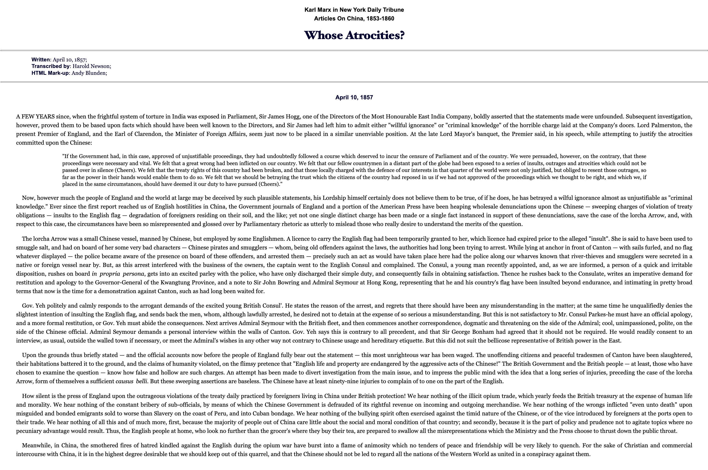
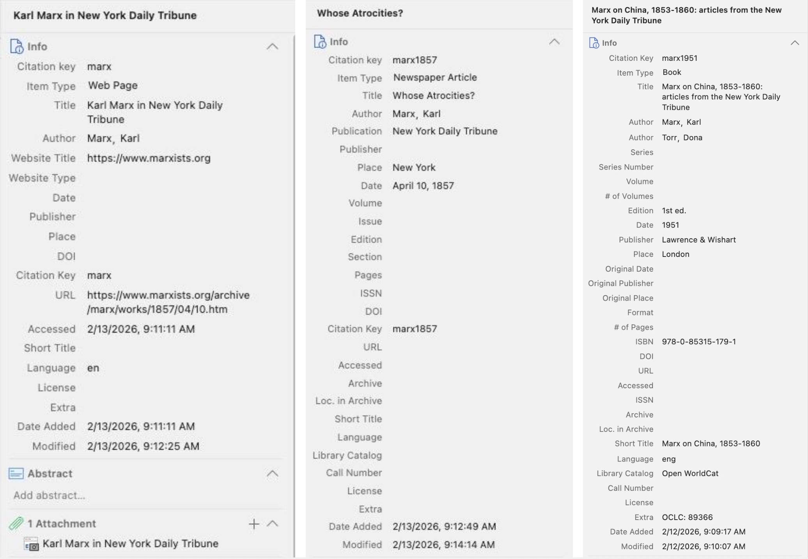
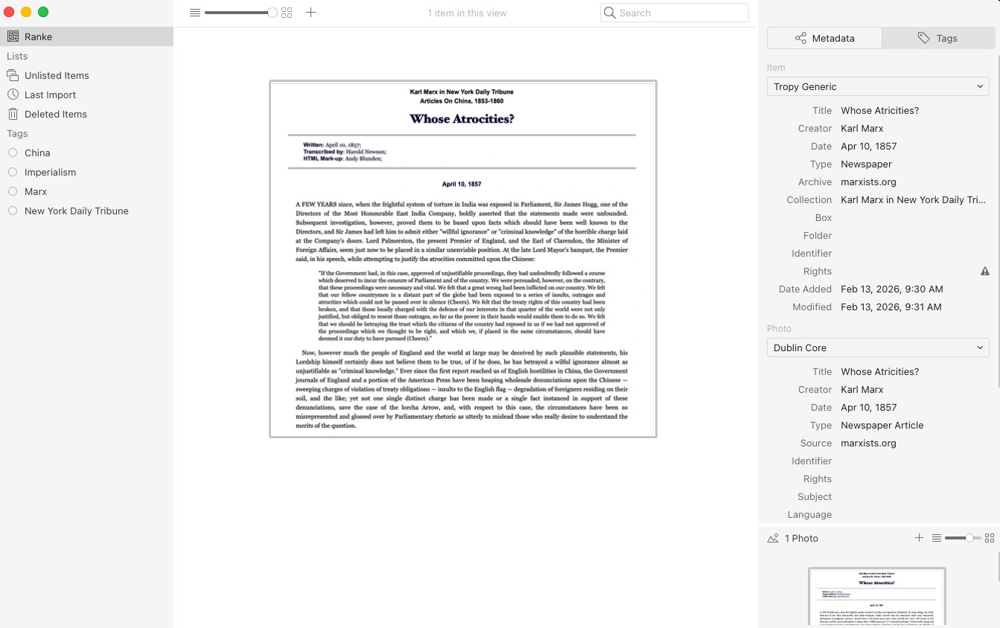
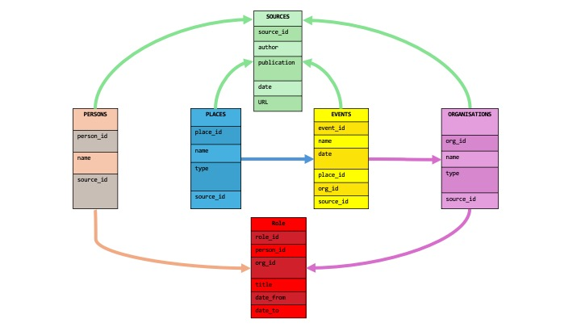
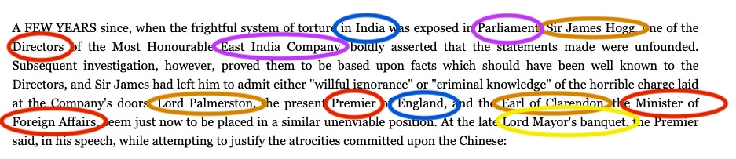
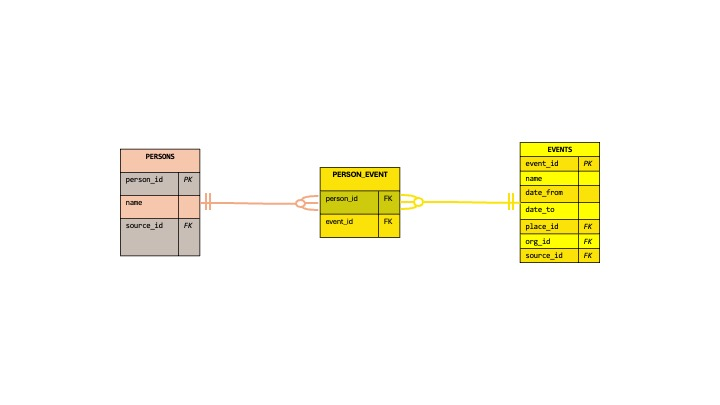
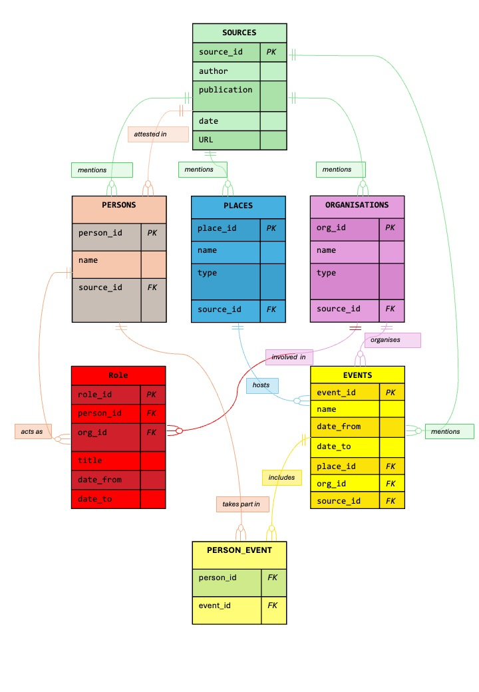
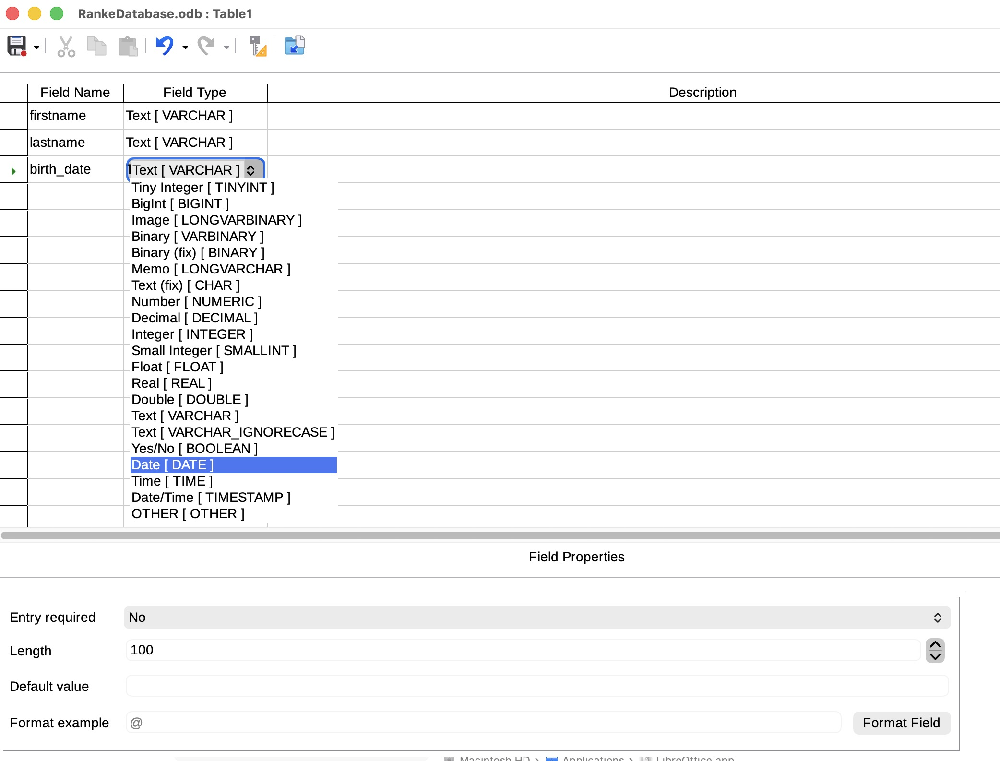

The previous section highlighted the creation of single tables to describe one type of object. But historical sources usually involve many different kinds of objects at once – people, places, organisations, events, etc. – and various connections between these objects. Furthermore, if historians need to analyse hundreds or thousands of documents, the information may quickly become repetitive and complex to manage. When spreadsheets are no longer sufficient to effectively work with sources, relational databases come into play. Based on [specific software](https://en.wikipedia.org/wiki/Database#Database_management_system), databases were designed to organise large amounts of information while preserving the connections between the described objects.

This section focuses on the concept of data models and the principles underpinning their implementation, using a simple example of a historical source (a newspaper article). Technical notions are explained briefly, but mastering them in depth is beyond the scope of this lesson. Help can be found in the resources proposed in the reading suggestions.

<!-- more -->

<!-- briefing-student -->

### Instructions
<!-- section-contents -->

Look at the following source: Karl Marx. Whose Atrocities? New York Daily Tribune, 10 April 1857. [URL](https://www.marxists.org/archive/marx/works/1857/04/10.htm).

If you have a problem accessing the resource, please consult this [archived URL](https://web.archive.org/web/20260000000000*/https://www.marxists.org/archive/marx/works/1857/04/10.htm).

Figure

The source is a newspaper article by Karl Marx, published on 10 April 1857. For the purpose of this lesson, it will be considered as part of a collection of articles on UK policy towards China from which a database should be constructed. 

The image you see in the above figure represents the transcribed version of the article as published on the website [marxists.org](https://www.marxists.org/). This version is itself a digitisation of an edited volume published in 1951 assembling all articles on China authored by Marx in the *New York Daily Tribune*. The media archaeology that traces the different ontological levels of our source (web page, book chapter, newspaper article) can be traced in the screenshots below that display different captures taken from [Zotero](https://www.zotero.org/), the popular software for managing bibliographical information.

The same source would look like this if captured in [Tropy](https://www.tropy.org/), the software specifically designed to manage archive photos:

The exercises in the following subsections use the source as specified at the beginning of the section (newspaper article) and provide specific instructions.

<!-- section -->

### 4.a Designing a data model | 35 mins  
<!-- section-contents -->
 
Designing a data model
Historians decide what information they want to record in a spreadsheet or database depending on their research question. This is the basis on which they select categories and determine which data they want to capture from a historical source. The selection of categories and the way they relate to each other is called a data model.

A data model defines how the information is divided and organised:

* Which types of information will be described as categories
* Which attributes will be recorded for each category
* How the different parts will relate and connect to each other

Different research questions require different data models. A model can follow a source-centred (or document-centred) approach, in which information is extracted about each object and connected to the source that mentioned it. By contrast, a method-centred approach represents only selected objects as entities and how they are related to each other. In theory, the research question comes first and the data model is built on the basis of it. In practice, however, designing a data model is more of an iterative process, moving back and forth between the initial research question, limitations imposed by the sources, such as ambiguities, and requirements related to the chosen analytical method.

Consider the source above.

Imagine you are researching British political figures involved in the UK’s policy on China in the 19th century.

1. Which types of information would you record? Define relevant descriptive categories.
2. What would be the essential information to extract for these categories? Define the attributes for each category.
3. Think of ways in which the categories you have defined relate to each other. Imagine arrows connecting them and try to find a verb for each arrow.
4. Think about which information in the article can be ignored.

Use a pencil and paper to draw your ideas.
Now look at the following image. This is what a data model for this source could look like. Ignore the technical details and focus instead on what you can understand.

1. Can you recognise types of information that represent descriptive categories based on the article?
2. Can you identify what kind of information is considered important based on the attributes of each category?
3. Can you understand how the categories are related? How would you interpret the arrows connecting them?

Building a data model in practice raises further questions, and the following subsections will focus on these from a conceptual point of view.

<!-- section -->

### 4.b  Extracting historical information from sources | 10 mins
<!-- section-contents -->
Before building a database, historians must identify the information they want to record. In this exercise, we are going to extract names, places, organisations and events from our historical sources. We are actually going to perform a simplified, non-automatised form of [named entity recognition (NER)](https://en.wikipedia.org/wiki/Named-entity_recognition).

Look at the source excerpt above.

* List all the people mentioned.
* List all the places mentioned.
* List all the organisations mentioned.
* List all the events mentioned.

Which entities were easiest to identify? Which were more ambiguous?

<!-- section -->

### 4.c Organising complex historical information | 25 mins
<!-- section-contents -->
Building a data model in practice raises further questions, such as how to handle a person known by several different names or titles or how to show that one person can be linked to several different jobs or roles (as with Karl’s many publications in Section 3). These are not flaws in your model, but design decisions every historian working with data has to make.

Imagine that you repeat the previous exercise for 500 newspaper articles. Suppose Lord Palmerston appears in 50 of the articles. Try to answer the following:

* How would you record the different political roles he held during the period covered by Marx’s articles?
* How would you handle the different titles used to refer to him?
* How would you group references such as “the Premier”, “his Lordship” and “Lord Palmerston” so that they are all recognised as referring to the same person without ambiguity?

Reflect on why a spreadsheet can become difficult to manage when information is repeated, ambiguous, uncertain or complex.

The database software itself doesn’t know that “Lord Palmerston” and “the Premier” are the same person – that decision is made by whoever builds the data model. Once it is made, though, the database enforces it: Palmerston exists only once, under a unique identifier, and every event, office or source that refers to him simply stores that one identifier instead of repeating his name each time.

<!-- section -->

### 4.d Implementing a data model in a relational database | 30 mins
<!-- section-contents -->
Databases are the main carrier for digital data. They can store a great variety of different types of data. But their true value comes from their ability to run queries over all of their content. By using queries, we can obtain specific information, evaluate the magnitude or duration of phenomena and detect patterns in the data.

To make all of this possible, relational databases rely on a few key principles. A relational database organises information into separate tables, each centred on the objects selected for the research, where every row represents one specific occurrence of the object. Every record needs a **primary key** – a unique identifier that distinguishes it from all others, even if names or descriptions are identical across sources. **Foreign keys** allow tables to reference each other, so that a person, a place or an organisation only needs to be described once and can then be linked to as many events or sources as needed. Where relationships are complex, for example if one person was involved in many events and/or we have to deal with one event involving many people, **junction tables** store the connections without duplicating data. Together, these mechanisms allow historians to ask questions that cut across many sources at once.

The key principles presented below are based on the specific case of the example database outlined in a separate section.

**Primary keys**. How do you make sure each row can always be distinguished from the others? Titles like “Earl of Clarendon” don’t help on their own – this is a hereditary title, so different men held it at different points in history. The name alone doesn’t tell you *which* Earl of Clarendon a source is talking about. A primary key solves this: it is a short code, invented once and never reused, that belongs to exactly one row, permanently. These identifiers should follow a consistent, systematic pattern – you cannot just use a label at random. In our example database, people are coded P001, P002, P003…, places follow their own pattern (L001, L002…) and events follow another pattern (E001, E002…). A consistent scheme like this makes it immediately clear which table an identifier belongs to and keeps the whole database manageable as it grows. Imagine trying to keep track of thousands of records with inconsistent *ad hoc* labels!

| person_id | name | source_id |
|---|---|---|
| P001 | Sir James Hogg | S001 |
| P002 | Lord Palmerston | S001 |
| P003 | Earl of Clarendon | S001 |

`P003` always means *this specific* Earl of Clarendon – the one described in our source –, no matter how many other Earls of Clarendon existed before or after him.

**Foreign keys**. Once every row has its own permanent ID, tables can be linked without repeating information. A foreign key is simply a primary key from one table copied into another table to point back to it. Instead of adding “Lord Palmerston, Premier of England” to every event he attended, we just write `P002`, and the database follows that pointer back to the full record for that person whenever needed.

| role_id | person_id | org_id | title |
|---|---|---|---|
| RO003 | P003 | O002 | Minister of Foreign Affairs |

Here,  `person_id` and `org_id` are foreign keys: they don’t describe the Role row itself but instead point to where the full details are found.

Check the example database in 4.e. Can you explain in your own words why `P003` in the Office table is a foreign key, not a primary key? What is the primary key of that Office row instead?

**Junction tables**. Some relationships cannot be stored with a simple foreign key. Take the Lord Mayor’s banquet (E002): both Palmerston (P002) and Clarendon (P003) took part in it. If you tried to add a person_id column to the Event table, you could only fit one person per event – there is no room for a second. If instead you tried adding an event_id column to the Person table, you would run into the same wall from the other side: Palmerston alone appears at several events, not just one. Junction tables solve this by giving the relationship itself its own table, with one row per pairing rather than per person or per event. A row like P002 – E002 simply states “Palmerston took part in the banquet”; a second row, P003 – E002, states “Clarendon took part in the banquet too” – both can exist side by side, without forcing either the Person or the Event table to hold more than one value per field. This is exactly what the Person–Event table does: every row links exactly one person to exactly one event, and as many rows as needed can share the same person_id or the same event_id. Together with primary and foreign keys, junction tables let historians ask questions that cut across many sources at once – “who attended which events, and when?” – in ways a single spreadsheet, with its one-row-per-record limit, cannot represent.

Of course, there are rules to follow when creating a database: primary keys cannot be empty, the types of data (textual, numerical, etc.) need to be specified and so on. But any software used to create a database (like the free [Libre Office Base](https://www.libreoffice.org/DISCOVER/BASE/)) will remind you of these rules to ensure that your database works. As the aim of this lesson is to explain what lies behind a database, please consult the references (Julien 2024) and (Cosovschi 2024) in the reading suggestions to learn more about implementing a data model.

<!-- section -->

### 4.e Example database – Sources | 60 mins
<!-- section-contents -->
The example below follows a source-centred (or document-centred) design in which each person, place and organisation is connected to the source that mentioned them (via source_id). This approach is used when extracting information from a single document. An entity-centred approach takes the opposite path: the person named Palmerston exists as just one single entry in the table and is linked to all the sources that mention him. This is what happened in the table in 4.c when we decided to include more than just a single article. In most research projects, you will have to use both approaches. When designing your data model, it is important to decide whether the document-centred or source-centred approach is best.

Note that historians are often faced with uncertainty, whether questions regarding facts or doubts as to whether sources are completely reliable in terms of the facts they state as true. We have already encountered two ways to handle this: we can use a set of Boolean flags, as in the example of creating subsets of the entity `Place` in the form of `is_region` / `is_country` / `is_city`, or a precision label, for example capturing a date (e.g. 1857) and adding a precision label drawn from a fixed vocabulary (for example `exact`, `circa`, `before`, `after`, `unknown`). We can employ the same idea of adding a “certainty/uncertainty” label to any value. In the case of a person’s name, for example, we could simply add additional `name_certainty` column, using lables like `confirmed`, `probable`, or `disputed` to record whether a pseudonym or alias in a source can be confidently attributed to one particular person.

If we create tables for all the different types of information or entities, we could have four tables (five, if the source itself also gets one, here table 1): Person (table 2), Role (table 3), Place (table 4) and Organisation (table 5). We should also have another table for historical events containing all of the entries above. Now the magic happens in the junction tables used to store the relationships (or connectors). Here, there are relationships between people and organisations (as in our table 3) or people and events (our table 7)

#### Table 1 – Source

| source_id | author | publication | date | url |
|---|---|---|---|---|
| S001 | Karl Marx | New York Daily Tribune | 1857-04-10 | [https://www.marxists.org/archive/marx/works/1857/04/10.htm](https://www.marxists.org/archive/marx/works/1857/04/10.htm) |

#### Table 2 – Person

| person_id | name | source_id |
|---|---|---|
| P001 | Sir James Hogg | S001 |
| P002 | Lord Palmerston | S001 |
| P003 | Earl of Clarendon | S001 |

In a relational database, Palmerston exists exactly once as row `P002`. Every event, office or source that mentions him simply stores `P002`. You can then ask questions that cut across all your sources at once: *“Select every event involving people who held an office in the British Government, sorted by date.”* A spreadsheet cannot answer that, but a relational database answers it in a single query, however many sources you have gathered.

*Note that we only see the first three entities here; further people in the excerpt to be included in this table are Harry Parkes (the Consul), Sir John Bowring, Admiral Seymour, etc.*

#### Table 3 – Role

This table records genuine historical information: **which role a person held in which organisation, and for how long**. Each row also happens to name both a person and an organisation, which is what lets it double as the connector between the Person and Organisation tables – but unlike the Person–Event table below, it isn’t a *real* junction table, since the role and dates are meaningful data in their own right, not just a link.

| role_id | person_id | org_id | title | date_from_value | date_from_precision | date_to_value | date_to_precision |
|---|---|---|---|---|---|---|---|
| RO001 | P001 | O001 | Director | | unknown | | unknown |
| RO002 | P002 | O002 | Premier of England | 1857 | before | 1857 | after |
| RO003 | P003 | O002 | Minister of Foreign Affairs | 1857 | before | 1857 | after |

**A note on structuring dates.** Historical dates are rarely exact, and a plain text field like “ca. 1853” or “before 1857” can’t be sorted, filtered or compared by a computer – it’s just a string of characters to the software. A more analysable approach splits the date into two parts: a **value** the software can actually read (a year, or a full date when known), and a **precision** label from a fixed small vocabulary (exact, circa, before, after, unknown) that records how certain that value is. You lose nothing – the historical uncertainty is still fully recorded – but the value column now becomes something a database can genuinely work with. Historians working with larger or more uncertain date ranges may want to look at the [Extended Date/Time Format (EDTF)](https://www.loc.gov/standards/datetime/) standard, which offers a more comprehensive vocabulary for precisely this problem.

#### Table 4 – Place

| place_id | name | is_region | is_country | is_city | source_id |
|---|---|---|---|---|---|
| L001 | India | TRUE | TRUE | FALSE | S001 |
| L002 | England | FALSE | TRUE | FALSE | S001 |
| L003 | Canton | FALSE | FALSE | TRUE | S001 |

Why do you think there are three separate columns to specify the type of place? Why not only one? 

**A note on the type column.** A single field should always hold one clear, unambiguous value – the same principle that makes primary keys work also applies here. Writing “Region / Country” into one type cell bundles two separate facts together, which makes the column hard to filter or count reliably (should a query for “all countries” also return this row, or not?). A cleaner approach is to give each possible category its own column, with a simple yes/no (Boolean) value, so that a place can belong to several categories at once without ambiguity. If the number of categories is likely to increase, an alternative would be to use one type column and list the possible values in a controlled vocabulary – but note that this goes beyond the scope of this lesson. 

#### Table 5 – Organisation

| org_id | name | type | source_id |
|---|---|---|---|
| O001 | East India Company | Trading company | S001 |
| O002 | British Government | State authority | S001 |
| O003 | British Parliament | Legislative body | S001 |

#### Table 6 – Event

The Event table is the connecting hub.

| event_id | name | date_value | date_precision | place_id | org_id | source_id |
|---|---|---|---|---|---|---|
| E001 | Exposure of torture system in India to Parliament | 1853 | circa | L001 | O003 | S001 |
| E002 | Lord Mayor’s banquet – Palmerston’s speech | 1857 | circa | L002 | O002 | S001 |
| E003 | Arrest of sailors aboard the *Arrow* | 1856-10-08 | exact | L003 | O001 | S001 |

#### Table 7 – Person–Event 

The Person–Event table is the junction table.

|compos_pers_ev_id | person_id | event_id | role_in_event              |
|---|-----------|----------|-------------------------------------------|
| PE001  | P002      | E002     | Speaker (as Premier)                 |
| PE002  | P001      | E001     | Director (respondent)           |
| PE003  | P003      | E002     | Attendee (as Minister of Foreign Affairs) |

Because one person can participate in many events and one event can involve many people, this relationship is **many-to-many** – it cannot be stored in either the Person or Event table alone. The junction table holds one row per person–event pairing. Both person_id and `event_id` are foreign keys; **together** they form the primary key of this table (a *composite* primary key), because what is unique here is the *combination* – the same person can appear in multiple events, and the same event can appear across multiple persons, but a specific person can only be linked to a specific event once.

A *query* is simply a question you ask the database in its own language – usually SQL, though the concept matters more here than the exact syntax. For example, you could ask: “Who was present at the Lord Mayor’s banquet?” and the database would select all rows where `event_id = E002`, returning `P002` and `P003`.

Now we have a very basic architecture of a database containing several different types of tables that are related to each other (much like hyperlinks in a web document, but more powerful and flexible). A visual representation would look something like this:

**Reading the diagram: cardinality and optionality.** Every relationship line carries two pieces of information at each end: *cardinality* (how many – a single bar means “one”, a crow’s foot means “many”) and *optionality* (whether it is required – a bar means “must exist”, an open circle means “zero is allowed”). Take Source–Person: the bar next to Source means every Person must belong to exactly one source (mandatory); the crow’s foot next to Person means one source may be linked to many people – or, in principle, to none at all if a source names no individuals (optional). [Wikipedia](https://en.wikipedia.org/wiki/Entity%E2%80%93relationship_model#Crow's_foot_notation) uses the same three symbols: ring = zero, dash = one, crow’s foot = many.

| Symbol | Meaning |
|---|---|
| `\|\|` | exactly one (mandatory: minimum 1, maximum 1) |
| `o\|` | zero or one (optional: minimum 0, maximum 1) |
| `\|<` | one or many (mandatory: minimum 1, maximum many) |
| `o<` | zero or many (optional: minimum 0, maximum many) |

*Reading rule: the symbol placed next to an entity’s name describes **that entity’s** multiplicity per one instance of the entity on the other end of the line. Example: Source || ⋯ o< Person reads as “one Source may be linked to zero or many Persons; every Person belongs to exactly one Source.”*

#### Comprehensive relation type overview

| Relation type | Notation | Example |
|---|---|---|
| One-to-one, optional (0,1 – 1,1) | `Person o\| -- \|\| WikidataEntry` | Not every Person in our dataset has (yet) been linked to a Wikidata entry, but once linked, one Wikidata entry corresponds to exactly one Person. |
| One-to-many, optional many (1,1 – 0,N) | `Source \|\| -- o< Person` | One newspaper article may name zero, one or several people; every Person record belongs to exactly one Source. |
| One-to-many, mandatory many (1,1 – 1,N) | `Organisation \|\| -- \|< Office` | An Organisation only enters our database because at least one Office (a role held within it) was recorded; the same Organisation may have many recorded office holders. |
| Many-to-one ((mirror image of the row above) | `Office o< -- \|\| Person` | Many Office records can point back to the same Person – Palmerston alone accounts for two (Foreign Secretary, then Prime Minister) – but every single Office record belongs to exactly one Person. |
| Many-to-many, optional both sides (0,N – 0,N) | `Person o< -- o< Event` | One person can take part in many events, and one event can involve many people – captured by the Person–Event junction table. |

**One-to-many and many-to-one describe the same relationship from two directions.** Looking from Source to Person, one article can mention many people (*one-to-many*); looking from Person to Source, every Person record belongs to exactly one article (*many-to-one*). It is the same arrow, just read from opposite ends – which is why you will sometimes see the identical relationship labelled “1:N” in one textbook and “N:1” in another.

**A note on scaling to many sources:** The table design shown above works well for a source-centred approach, where every Person, Place and Organisation simply points back to the one source they came from. But imagine building a database from a whole corpus – say, 500 newspaper articles about British foreign policy. Lord Palmerston would then *be mentioned in* many different sources, not *created by* one. Giving a Person a single `source_id` column would force you to either duplicate Palmerston’s row for every article he appears in (defeating the whole purpose of deduplication described above) or arbitrarily pick just one source to “own” him. The correct solution is a junction table, which we will refer to as `Mention`, which records every time a person is named in a source, while the Person row itself stays unique.

Mention Table (Person ↔ Source junction table)

| mention_id | person_id | source_id |
|---|---|---|
| M001 | P002 | S001 |
| M002 | P002 | S045 |
| M003 | P002 | S078 |

Palmerston (`P002`) still exists only once in the Person table but now appears in three rows of the Mention table, making this a many-to-many relationship between Person and Source.

However, a database is subject to good old source criticism too: entering a piece of information from a source into a table does not make it any more certain or reliable; it still needs to be critically evaluated for provenance, perspective and credibility. But uncertainty can be integrated explicitly into the data model, as we did in the case of the date, for instance. The fundamental principle of all historical research must always be critically engaging with any source material, whether digital or not, rather than considering information found in historical sources as solid facts!

<!-- section -->

### 4.f Linking the database | 20 mins
<!-- section-contents -->
So far, every relationship in our database has allowed at least one side to have several partners. But historians and archivists also regularly work with [authority records](https://en.wikipedia.org/wiki/Authority_control) – external, standardised vocabularies defined by cultural institutions.

[Wikidata](https://www.wikidata.org/), a free and open knowledge base, assigns exactly one unique identifier (a “QID”, e.g. `Q193656`) to each distinct real-world entity it describes. Linking our Person table to Wikidata gives a genuine **one-to-one relationship**: each Person in our database corresponds to at most one Wikidata entry, and each Wikidata entry we link corresponds to exactly one Person – never several.

**Identifier** (new table)

| person_id | wikidata_qid |
|---|---|
| P002 | Q193656 |

1. Go to [wikidata.org](https://www.wikidata.org/) and use the search bar at the top of the page.
2. Search for “Lord Palmerston” (or one of the other people from our source, e.g. “Earl of Clarendon”).
3. Open the corresponding entry. The QID appears directly under the title, in the form (Qxxxxxx), and also in the page’s URL.
4. Add the QID as a new row in the Identifier table above.

Which people from our source were easy to find on Wikidata? Were there any for which you were unsure whether you had found the right entry?

The relational model is not the only way to organise data. [NoSQL](https://en.wikipedia.org/wiki/NoSQL) databases (a loose family including document stores, key–value stores and graph databases) work without fixed tables and predefined columns: each record can have its own structure, providing more flexibility for heterogenous data or dynamic, evolving collections. A popular model that could also be used for the example used in this lesson is [RDF (Resource Description Framework)](https://en.wikipedia.org/wiki/Resource_Description_Framework): it does not use tables but expresses information in simple three-part statements consisting of subject–predicate–object (so-called “triples”). In our case, one triple would be `Palmerston` – `held office` – `Prime Minister`. Wikidata is based on this principle, and linking the Person table to a Wikidata QID is a first step towards an RDF-based linked-data model that connects data from various sources and in various formats.

 

<!-- section -->

### 4.g Extending the database | 30 mins
<!-- section-contents -->
This exercise builds on the previous subsections.

The article by Karl Marx provided at the beginning of section 4 refers to the Arrow Incident.

Consult the [Wikipedia article on the Second Opium War](https://en.wikipedia.org/wiki/Second_Opium_War) to learn more.

* Add the event to the Events table.
* Identify any additional people, organisations or places that should be included.
* Do you need new tables? Why?

<!-- section -->

### Reading/viewing suggestions
<!-- section-contents --> 
Nodegoat. What Is a Relational Database? Accessed 4 June 2026. https://nodegoat.net/blog.s/20/what-is-a-relational-database.

Cosovschi, Agustín. “From Sources to Data: Designing a Database for the Humanities and Social Sciences with Nodegoat”. *Programming Historian*, 29 February 2024. https://programminghistorian.org/en/lessons/designing-database-nodegoat.

Julien, Octave. Creating and using databases in medieval history: historiography, concepts and practice. Seminários do GIHM, April 2024, Porto, Portugal. ￿[halshs-04550456￿](https://shs.hal.science/halshs-04550456v1)

Robertson, Stephen. “The properties of digital history”. *History and Theory* 61 (4) (2022): 86‑106. [DOI](https://doi.org/10.1111/hith.12286).

Viale, Mattia. “From the Historical Source to a Database: A Short Story”. *Refashioning the Renaissance*, 21 November 2018. https://refashioningrenaissance.eu/from-the-historical-source-to-a-database/.

<!-- briefing-teacher -->
