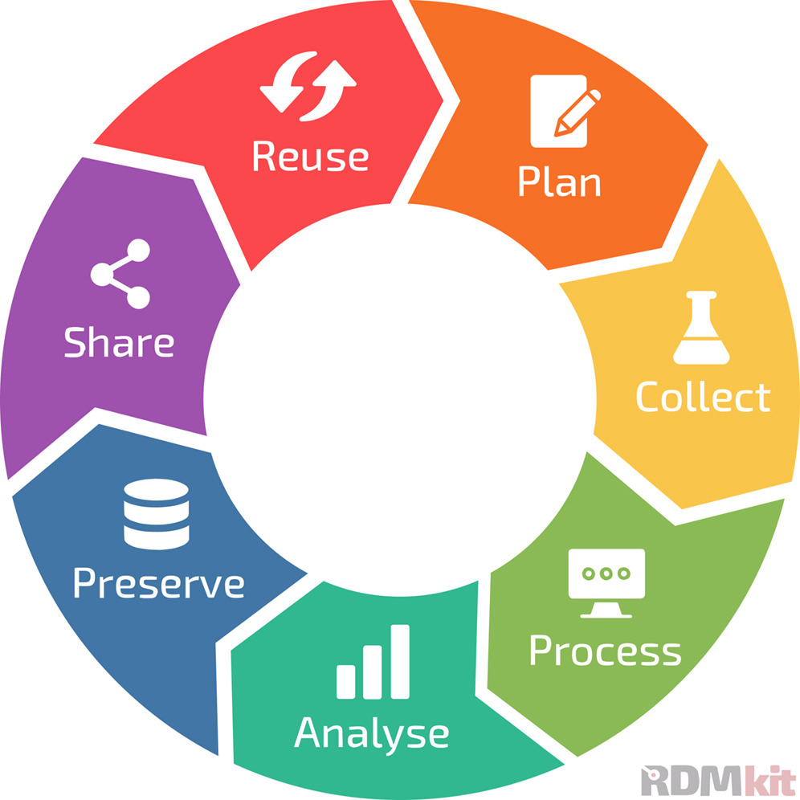

Ethical obligations arise at every stage of handling data, from the initial point of creation or collection to eventual archiving or deletion. This assignment introduces the concept of the research data lifecycle, shows how it is described in two prominent data management frameworks, and asks you to apply it to the case study that runs through this lesson: a local history project involving oral testimonies and family photographs.

<!-- more -->

<!-- briefing-student -->

### Instructions
<!-- section-contents -->

Watch the video animation above following Lea as she discovers and documents the objects left by her grandmother.

<!-- section -->

### 2.a What a data lifecycle is and how it matters for ethics | 25 mins  
<!-- section-contents -->
Simply put, data lifecycles illustrate the stages that data go through and the notions that are tied to them (e.g. datasets and databases – see lesson 1). The notion was developed as part of data management practices.

[RDMkit](https://rdmkit.elixir-europe.org/data_life_cycle){:target="_blank"} is the research data management toolkit developed by ELIXIR Europe, the European research infrastructure for life science data. Its data management principles are widely applicable across disciplines, including history and the humanities (Coppens et al. 2021).  

Figure 1. The data lifecycle. Source: [RDMkit: A research data management toolkit for life sciences](https://doi.org/10.1016/j.patter.2025.101345){:target="_blank"}. CC BY. 

Go to the [RDMkit website](https://rdmkit.elixir-europe.org/data_life_cycle){:target="_blank"} and look at the lifecycle diagram.

The RDMkit model describes a research lifecycle with the following stages: 
* Plan 
* Collect 
* Process
* Analyse 
* Preserve
* Share 
* Reuse

Click on each stage on the RDMkit diagram and read the description. As you read, pay attention to the following:

* At which stage(s) is the question of consent explicitly present?
* Where in this lifecycle do you think the question of ownership most naturally arises? At which stage might it become most urgent?
* Consider the final stage, “Reuse”. What ethical obligations might arise specifically at this stage – that is, when data created for one purpose is reused for another?

For the purposes of this lesson, we use a combined model that draws on RDMkit and relevant literature (Owens 2018; Corti et al. 2019):
* Planning: deciding what data to collect, for what purpose and under what conditions.
* Acquisition/Collection: gathering data, whether by creating it (interviews, surveys, photographs) or by locating it in existing sources (archives, databases, digitised collections).
* Processing/Analysis: cleaning, transforming and analysing data to produce findings.
* Interpretation/Modelling: drawing conclusions and representing them in argument, visualisation or model form.
* Publication: sharing findings – and, increasingly, the underlying data – with other researchers and the public.
* Archiving and Reuse: depositing data in a repository for long-term preservation and potential reuse by others.

Extra: The SSHOC League of Data (SSHOC LoD) is a pilot gamification of the CESSDA Data Management Expert Guide® (DMEG) (<https://lod.sshopencloud.eu>{:target="_blank"}). 

<!-- section -->

### 2.b Ethics across the data lifecycle | 40 mins 
<!-- section-contents -->
Return to the video animation: we know that Lea has her family’s oral testimonies and photographs from community members, and that she has digitised them. Now she wishes to make this material available through the online archive of a local history project.

When Lea digitised these materials, [she turned them into digital data](../construction-of-data/#assignment-01-what-are-data.en). Following the data lifecycle stages, we will trace the main ethical questions that arise at each stage for this project.

For the sake of the exercise, focus on the stages of acquisition/collection, publication and archiving/reuse. For each stage, we have provided a brief description of the situation and a set of questions. If you are working in a class, these can be discussed in small groups; if working alone, write brief notes on each.

#### Acquisition/Collection

Imagine that Lea conducts recorded interviews with twelve community members; she also receives donations of more family photographs. She obtains [consent forms](https://kclpure.kcl.ac.uk/portal/en/publications/consent-in-the-digital-context-the-example-of-oral-history-interv/){:target="_blank"} from each participant.

* One participant asks that their interview be kept confidential during their lifetime but made available after their death. How should Lea record and manage this condition? What happens if she loses the consent form? 
* The photographs were taken by various family members over several decades. Who holds copyright: the person who took the photograph, the person depicted in it, the person who donated it or the family as a whole? How can you find out?

> Data minimisation is the principle of collecting only the information actually needed to meet the objectives of a project. This means that even if you can, and even if contributors offer it, you do not collect more information than necessary. Data minimisation is both a key principle in regulations on personal data, such as the GDPR, and a good research practice.

Going further: Are there categories of information Lea should not collect, even if contributors offer them?

#### Publication

Lea is now ready to make the collection available online.

* Two interviewees have died since the interviews were conducted. What are Lea’s obligations – should she contact their heirs, and if so, what for?

<strong>What happens to consent when a contributor dies? (click to expand)</strong>
 

In most legal frameworks, privacy rights do not survive death, meaning that the personal data of a deceased individual is generally no longer protected under regulations such as the GDPR. However, legal frameworks vary by country, and some national laws do extend certain protections beyond death. Beyond the legal question, there is also an ethical one: even if the law does not require it, many archivists and researchers consider it good practice to notify next of kin before publishing material involving deceased individuals, particularly when that material is of a sensitive or personal nature. Oral history associations have developed specific guidelines on this matter.

 

For guidance: [Oral History Association. Archiving Oral History — Ownership and Rights Management](https://oralhistory.org/archives-principles-and-best-practices-complete-manual/){:target="_blank"}

* What licence should Lea attach to the published material? What are the implications of choosing a [Creative Commons](https://creativecommons.org/){:target="_blank"} attribution licence versus a more restrictive licence, or no licence at all?

<strong>What is a licence? (click to expand)</strong>

When you make a document, photograph or any other creation publicly available, a licence tells others what they are and are not allowed to do with it. Without a licence, the default position in most countries is that all rights are reserved, meaning that no one can legally reuse the material without requesting permission. Creative Commons (CC) licences offer a flexible middle ground. They allow creators to share their work while specifying the conditions of reuse. The most common conditions are:
BY (Attribution) – anyone can reuse the material, provided they credit the creator
NC (Non-Commercial) – reuse is permitted for non-commercial purposes only 
ND (No Derivatives) – the material may not be modified or transformed 
SA (Share Alike) – adaptations must be shared under the same licence
These conditions can be combined. For example, CC BY-NC allows reuse with attribution but not for commercial purposes. The most open licence, CC BY, requires only attribution. The most restrictive, CC BY-NC-ND, limits reuse to non-commercial contexts and prohibits any modification. For more information, see the Creative Commons website.

* Sometimes, the consent given at the collection stage may not be sufficient for the publication stage. Think about the difference between consenting to an interview and consenting to your words being permanently and publicly accessible on the internet (Thompson and Bornat 2017).

####  Archiving and Reuse

At the end of the video animation, we see that Lea has the intention to contribute the digital data in her collection to a local history project that will then publish them on the project website. Lea essentially delegates the responsibility of long-term preservation to a regional digital archive. By making the data available online, she is also making it possible for this material to be downloaded or shared by anyone and reused in new contexts.
* Should Lea deposit all the material in her collection or only material for which there is clear consent for archival access? What happens to any material that might not be deposited?
* Suppose a researcher contacts the archive ten years later wanting to use the oral testimonies for a study on urban change. She proposes to apply computational text analysis to the transcripts. Is this use covered by the original consent? How can you find out, and what should you do if it is not?

<!-- section -->

### 2.c Drafting a data management plan and provenance table | 40 mins
<!-- section-contents -->
A data management plan (DMP) is a document that describes how data will be managed throughout a project. Most research funders in Europe now require one (European Commission 2016). For historians, a DMP serves a second purpose: it is a record of the provenance of the data – where it came from, how it was collected and what decisions were made along the way.
Using the structure below, draft a short DMP for Lea’s local history project. You do not need to write more than two or three sentences per section; the goal is to think through the ethical decisions, not to produce a polished policy document. Can you recognise the stages in the data lifecycle?

* Data description: What types of data are in the collection (audio, photographs, transcripts, metadata)? What formats? Approximately what volume?
* Consent and legal basis: How was consent obtained from participants? What is the legal basis for processing personal data (see the GDPR – legal bases may include consent or “public task”, i.e. a task performed in the public interest)? How will you manage the case of participants who wish to withdraw consent or who have since died?
* Ownership and intellectual property: Who holds copyright over the photographs and recordings? What agreements have been made with contributors regarding rights?
* Storage and security: Where will the data be stored during the project? Who will have access? How will sensitive data be protected against unauthorised access?
* Publication and sharing: Which data will be made publicly accessible, and under what licence? Which data will be restricted, and why? What level of access will be provided for restricted materials (e.g. researchers only, community members only, embargoed until a specified date)?
* Retention and archiving: How long will the data be retained? In which repository will it be deposited? What will happen to material that cannot be archived (e.g. material for which consent cannot be confirmed)?

Now complete a short provenance table for one type of material in the collection – for example, the oral history recordings. A provenance table records the origin and custody history of a data item. Use the following columns:

| Data item | Creator | Date/period | Original purpose | Acquisition method | Consent status | Rights holder | Transformations applied | Ethical notes | 
| -------- | ------ | ----- | ------ | ------ | ------ | ----- | ----- | ------ | 
| Aunt Maria’s recording | Grandmother | 1982 | To wish a Happy New Year | Donation | Consent given | Aunt Maria | No transformations | Mentions names of now deceased people |  

Fill in one row for one item of your choice. This exercise is designed to help you see how much ethical information is embedded in the apparently simple act of describing a source.

<!-- section -->

### Reading/viewing suggestions
<!-- section-contents --> 

RDMkit (ELIXIR Europe). Data Life Cycle overview. <https://rdmkit.elixir-europe.org/data_life_cycle>{:target="_blank"} – especially the “Human Data” section.

Digital Curation Centre. “Data Management Plans”. <https://www.dcc.ac.uk/resources/data-management-plans>{:target="_blank"}

ehe Turing Way Community. “A Handbook for Reproducible, Ethical and Collaborative Data Science”. <https://the-turing-way.netlify.app/>{:target="_blank"}

Oral History Society. “Ethical and Legal Matters”. <https://www.ohs.org.uk/ethics/>{:target="_blank"}
UK Data Service. “Consent for Data Sharing”. <https://ukdataservice.ac.uk/learning-hub/research-data-management/ethical-issues/consent-for-data-sharing/>{:target="_blank"}

<!-- briefing-teacher -->
