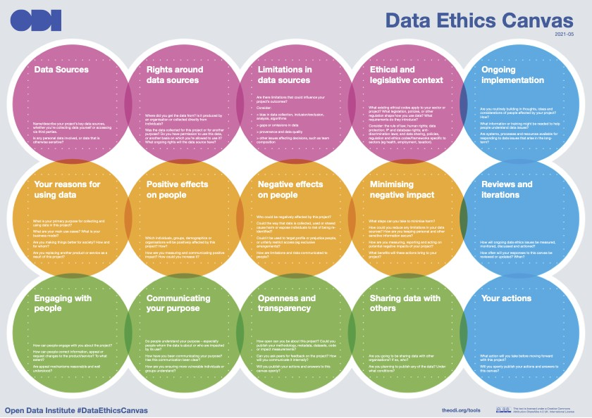

Sharing research data responsibly requires both technical rigour and ethical awareness. Two complementary frameworks guide this practice: the FAIR principles, which lay down the conditions for efficient and sustainable data sharing, and the CARE principles, which consider who benefits from data sharing and whose interests must be protected.

The FAIR principles emerged from the open science movement of the 2010s, which pushed for research data to be shared and reused rather than locked in incompatible systems. Sharing data effectively on the web requires it to be structured and described in ways that both machines and humans can read and process – this is the specific challenge the FAIR principles were designed to address (Wilkinson et al. 2016).

As open data initiatives expanded, marginalised voices pointed out that frameworks designed for scientific efficiency often replicated patterns of unequal power relations – data was being collected about communities without their meaningful participation or benefit. The CARE principles were developed by the Global Indigenous Data Alliance in direct response to this problem (Carroll et al. 2020).

<!-- more -->

<!-- briefing-student -->

### Instructions
<!-- section-contents -->

<!-- section -->

### 3.a Looking at data through the FAIR lens | 40 mins  
<!-- section-contents -->
 
Handle data with care and share if possible – this sounds like a good idea, but what does it mean in practice? The FAIR principles were published in 2016 by a consortium of researchers, librarians and data managers. They have since become a standard reference point in open science, required by major research funders in Europe and elsewhere (Wilkinson et al. 2016). Go to [the original paper in Scientific Data](https://doi.org/10.1038/sdata.2016.18){:target="_blank"} and read the abstract and the brief description of each principle (p. 1–3). Then explore the GO FAIR website (<https://www.go-fair.org/fair-principles/>{:target="_blank"}) for a more user-friendly explanation.

FAIR stands for:
* Findable: Data and metadata should be easy to find
* Accessible: The conditions in which data can be accessed should be clearly stated, based on the understanding that accessibility also means that some data may legitimately be restricted.
* Interoperable: Data should use standardised formats, vocabularies and ontologies so that it can be integrated with other datasets and used by different tools. For historians, this means using recognised metadata standards (e.g. Dublin Core, Europeana Data Model) and controlled vocabularies for names, places and dates.
* Reusable: Data should be accompanied by a clear statement or licence setting out the conditions associated with use, together with sufficient documentation describing the materials and the methodology so that other researchers can understand and build on the data.

Now navigate to [Zenodo](https://zenodo.org){:target="_blank"}, an open-access data repository.

We suggest that you work with the following dataset: Crymble, Adam, and Emma Azid. “Black Lives, British Justice: Black People in London Criminal Justice Records 1720-1841”. Zenodo, 28 August 2021. <https://doi.org/10.5281/zenodo.5304501>{:target="_blank"}.

* Does the dataset have a unique identifier such as a [digital object identifier ](https://en.wikipedia.org/wiki/Digital_object_identifier){:target="_blank"} (DOI)? Look for the DOI on the record page.
Then read what a unique identifier is [in the FAIR principles context](https://www.gofair.foundation/f1){:target="_blank"} (estimated reading time: 3 minutes). How do you think that it would allow another researcher to find the dataset reliably in ten years’ time?

* Is the dataset fully downloadable or are there access restrictions? Where on the page can you find this kind of information?
In comparison, look at a dataset with restricted access: Pepe, Antonio Gerardo, Roberta Alilla, Barbara Parisse and Flora De Natale. “Historical Dataset from the Italian National Agrometeorological Network (RAN)”. Zenodo, 21 January 2025. <https://doi.org/10.5281/zenodo.14710779>{:target="_blank"}. In this case, are existing restrictions clearly explained?

* In what format are the data files available? Are these [open](https://en.wikipedia.org/wiki/Open_file_format){:target="_blank"}, non-proprietary formats (such as CSV, plain text or open XML standards) or are they proprietary formats that may not be readable without specific software?
The FAIR principles recommend open formats because they make it easier to share, access and reuse data.
  
* Is there a [README](https://ubc-library-rc.github.io/rdm/){:target="_blank"} file or [data dictionary](https://ubc-library-rc.github.io/rdm/content/07_data_dictionary.html){:target="_blank"} that explains what the data contains and how it was collected? Is this documentation sufficient for you to understand the data without contacting the depositor?
  
* How are the rights of use specified? Can the data be reused, and if so under what conditions? (Tip: here you should look for a licence, as explained in 2.b)

<!-- section -->

### 3.b Looking at data through the CARE lens | 30 mins
<!-- section-contents -->
The FAIR principles focus on the technical aspects of making data accessible and reusable, but they do not address whether data should be shared and whose interests are considered. The CARE principles were developed by the [Global Indigenous Data Alliance (GIDA)](https://www.gida-global.org/careprinciples){:target="_blank"} to address this gap. They respond to concerns that open data practices, while efficient for science, can reinforce unequal power dynamics and extract knowledge from Indigenous communities (Carroll et al., 2020; Tuhiwai Smith, 2012). More broadly, CARE highlights ethical issues that arise in contexts where power is uneven and some voices are marginalised. The underlying concerns about consent, power, benefit and community authority apply to any situation in which researchers use data about communities that have historically been marginalised, exploited or excluded from the research process. Historians working with data about enslaved people, colonial subjects, asylum seekers or victims of state violence should ask the same fundamental questions (Risam 2019; D’Ignazio and Klein 2020).

CARE stands for:
* Collective Benefit: Data ecosystems should be designed so that the communities whose data is used derive genuine benefit from it. Research that extracts value from communities without returning anything to them fails to meet this standard, however technically FAIR it may be.
* Authority to Control: Indigenous peoples’ rights and interests in their data must be recognised, and their authority to control that data must be upheld. Communities should have a meaningful role in decisions about how their data is collected and used, not merely a right to refuse.
* Responsibility: Those who work with Indigenous data have a responsibility to explain how the data is used and to demonstrate that this use supports the community’s self-determination and collective benefit. This is ongoing, not a one-time compliance exercise.
* Ethics: Indigenous peoples’ rights and wellbeing should be the primary concern at all stages of the data lifecycle. This requires engagement with Indigenous ethical frameworks, not merely the application of institutional review board processes.

Now return to the same Zenodo dataset you examined in subsection 3.a. Apply the CARE framework.

* Who does the data describe? Are there living communities, or communities of descendants, whose interests are associated with this data?
* Is there any evidence that these communities were involved in designing the data collection or that they were consulted about how the data would be used and shared?
* Who benefits from the data being open: researchers, the institution that deposited it or the communities the data concerns? Try to be specific.
* Are there uses of this data that would be ethically problematic even if they are technically permitted by the licence? Can you think of an example?

<!-- section -->

### 3.c Handle with care, share if possible: evaluating Lea’s choices | 45 mins
<!-- section-contents -->
The photographs are a good place to notice that GDPR and CARE do not always ask the same question. From the perspective of individual consent, Lea has arguably done everything right: the individuals depicted, or the family members who donated the images, signed a deposit agreement, and a CC BY licence is a defensible, legally clean choice. But CARE asks something else – not “did the person in the photograph agree to this?” but “does the wider family or community have a stake in how this image circulates, one that cannot be dismissed just because a single signatory said yes?” Take the photographs depicting individuals whose living relatives were never contacted: legally, if the person depicted (or whoever holds the relevant rights) has already given their consent, nothing further may be required. For Lea’s three categories of material, where do the two frameworks point in the same direction and where do they start to pull apart?

The next exercise can be completed individually or in small groups.

Lea is ready to deposit her collection. She has three categories of material, each raising different ethical questions.

1. Oral history recordings and transcripts. Nine of the twelve participants have given explicit consent for public access. Two have asked for their contributions to be restricted to researchers at recognised institutions for twenty years. One has consented to sharing within the local history community only, not with the general public or with researchers outside the region.
2. Digitised family photographs. All were donated by community members who signed a deposit agreement allowing publication under a Creative Commons Attribution licence (CC BY). However, several photographs depict individuals whose living relatives have not been contacted.
3. Transcribed letters and diaries. The original authors died before 1954 and the texts are out of copyright. However, the letters contain detailed information about family conflicts, financial difficulties and health conditions that living descendants might find distressing if published without contextual framing.

For each category, consider the following questions:
* Is there any material that should not be made publicly available, even if it is legally permissible to do so?
* What CARE considerations apply? Whose interests and authority must be considered beyond the legal minimum?
* What licence would you attach to the material that can be shared?

Then reflect on the two frameworks together using the [Data Ethics Canvas](https://theodi.org/tools){:target="_blank"}, a planning tool developed by the Open Data Institute (ODI) to help people involved in projects think through who could be affected by how data is used and shared.

Figure 2. The Data Ethics Canvas. Source: [Open Data Institute](https://theodi.org/){:target="_blank"}. CC BY-SA 4.0

* Negative effects on people: who could be harmed if this material is published, and how? Could it expose someone, including living relatives who were never contacted, or reveal sensitive details about them?
* Sharing data with others: which part of the material would you share, with whom, and under what conditions or licence? Which part would you restrict or not deposit?
* The phrase *handle data with care and share if possible* captures the practical spirit of both frameworks together. Do you think *if possible* is doing important work in the phrase? What conditions would make sharing impossible, or irresponsible?
* Finally, consider the initial question and reflect on how the GDPR and the CARE principles point in the same direction for your category, and where they diverge.

<!-- section -->

### Reading/viewing suggestions
<!-- section-contents --> 
GO-FAIR. FAIR Principles. <https://www.go-fair.org/fair-principles/>{:target="_blank"}

Wilkinson, Mark D. *et al.* “The FAIR Guiding Principles for Scientific Data Management and Stewardship”. *Scientific Data* 3 2016: 160018. <https://doi.org/10.1038/sdata.2016.18>{:target="_blank"}

Global Indigenous Data Alliance. CARE Principles. <https://www.gida-global.org/care>{:target="_blank"}

Carroll, Stephanie Russo *et al.* 2020. “The CARE Principles for Indigenous Data Governance”. *Data Science Journal* 19 (1): 43. <https://doi.org/10.5334/dsj-2020-043>{:target="_blank"}.

O’Donnell, Dan. “Thinking about the CARE Principles in the Digital Humanities”. DARIAH-Campus, 16 December 2021. <https://campus.dariah.eu/resources/hosted/thinking-about-the-care-principles-in-the-digital-humanities>{:target="_blank"}.

D'Ignazio, Catherine, and Lauren F. Klein. *Data Feminism*. MIT Press, 2020. <https://data-feminism.mitpress.mit.edu/>{:target="_blank"} (see Chapter 4: “What Gets Counted Counts”).

[Traditional Knowledge (TK) Labels](https://localcontexts.org/labels/traditional-knowledge-labels/){:target="_blank"}. *A concrete tool for applying CARE principles to digital cultural heritage, developed by the non-profit organisation Local Contexts. TK Labels are digital notices that communities can attach to cultural heritage materials held in archives and museums, specifying their terms for access and use. Unlike licences, they do not define legal rights of use; rather, they add a layer of community-specific information about the cultural context and sensitivity of materials*.

[Mukurtu](https://mukurtu.org/){:target="_blank"}. *A content management system designed specifically for Indigenous cultural heritage. Mukurtu integrates TK Labels directly into the browsing experience, allowing communities to communicate the cultural protocols that govern access to and use of their material.*

<!-- briefing-teacher -->
