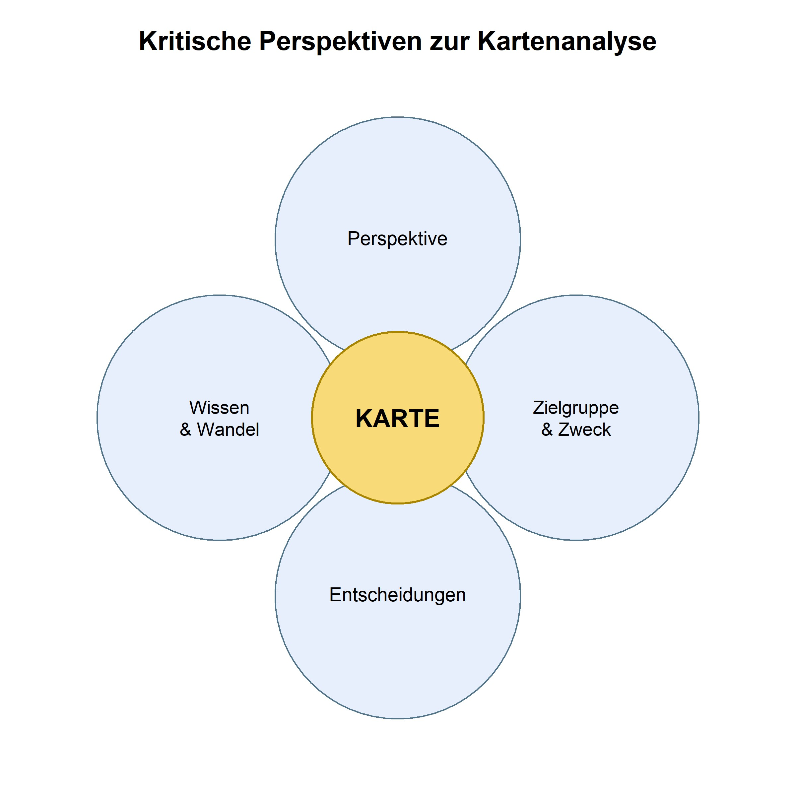

In diesem Abschnitt beschäftigen wir uns damit, wie man Karten im Rahmen der Geschichtsforschung liest und analysiert. Die nachfolgend dargelegten Grundsätze sollen Ihnen während der gesamten Lektion als Leitfaden dienen.
<!-- more -->

### Mehr über die Methodik
<!-- section-contents --> 

Im Prinzip sind alle Karten thematische Karten. Wir können zwischen Karten unterscheiden, die sich auf topografische Merkmale konzentrieren, wie beispielsweise Karten der Erdoberfläche, und Karten, die soziodemografische Daten, Strecken von öffentlichen Verkehrsmitteln, Kriminalität usw. darstellen. Die grundlegenden Schritte des Kartierungsprozesses gelten jedoch für alle Arten von Karten:
1. Auswahl der Kartenprojektion
2. Festlegung des dargestellten Gebiets
3. Gestaltung der Karte
4. Auswahl von Klassifizierungsmethoden und Kategorien
5. Auswahl eines Farbschemas für die Datenvisualisierung
6. Klare Definition der Zielgruppe
7. Beschriftung
8. Hinzufügung einer Legende
9. Festlegung eines Kartenlayouts
10. Bewusstsein für die visuelle Hierarchie

### Anleitung

Wie sollten wir historische Karten lesen? Unter Berücksichtigung der oben dargelegten Aspekte müssen wir die traditionellen Prinzipien der Quellenkritik mit Ansätzen kombinieren, die auf die Besonderheiten bei der Herstellung von Karten zugeschnitten sind.

Folgende Punkte sind dabei zu beachten: 

1. Perspektive
   - Kartograf: Wer hat die Karte hergestellt und wo?  
   - Kartenausschnitt und Maßstab: Was wird dargestellt (ein Teil der Welt, die Welt usw.) 
   - Kartenprojektion

2. Zielgruppe und Zweck
   - Verwendungszweck der Karte 
   - Aussage

3. Entscheidungen
   - Was ist auf der Karte dargestellt?
   - Welche Elemente fehlen?
   - Wie sieht die Darstellung aus?
  
4. Wissen und Wandel
   - Stand der Wissenschaft zum Zeitpunkt der Entstehung
   - Verfügbare Technologien zur Herstellung der Karte

Beim Durcharbeiten dieser Lektion können Sie Ihre eigene Checkliste zusammenstellen. Ergänzen Sie dazu weitere Elemente oder passen Sie die oben gezeigte Grundstruktur an. Am Ende werden Sie Ihren ganz persönlichen Katalog mit Kartenelementen erstellt haben.

Abb. 1: Wie historische Karten interpretiert werden. Erstellt vom Ranke.2-Team, basierend auf Michelle LeBlanc, Reading maps: How to analyze a map. 31. Oktober 2017 https://web.archive.org/web/20230529030026/https://www.choices.edu/video/reading-maps-analyze-map/  

{:.table.border.table-sm.text-sm.text-bold-highlight}
| 1. PERSPEKTIVE | 2. ZIELGRUPPE UND ZWECK | 3. ENTSCHEIDUNGEN | 4. WISSEN UND WANDEL |
|-------------------|--------------------------|----------------|---------------------------|
| Kartograf (Wer? Wo?) | Verwendungszweck (Welchem Zweck dient die Karte?) | Was wird gezeigt?| Damaliger Stand der Wissenschaft |
| Geografie (Umfang?) | Aussage (Botschaft?) | Welche Elemente fehlen? | Verfügbare Technologien |
| Kartenprojektion |  | Wie sieht die Darstellung aus? |  |

### Ein Beispiel
Dieses Video zeigt am Beispiel einer Afrikakarte aus dem 17. Jahrhundert, wie sich die oben erläuterten Prinzipien bei der Analyse historischer Karten anwenden lassen: Burns Library: [„How to Read a Historical Map“](https://youtu.be/1jY_6mRIPag) (6 Min. und 6 Sek.).

*Redaktioneller Hinweis:*

*Die Grundsätze des oben genannten Interpretationsrahmens wurden inspiriert von: Michelle LeBlanc, [Reading maps: How to analyze a map](https://web.archive.org/web/20230529030026/https://www.choices.edu/video/reading-maps-analyze-map). 31.10.2017 Brown University, Choices Program Curriculum Unit, Lesson: Interpreting a Native Map.  [https://web.archive.org/web/20230611015533/https://www.choices.edu/video-playlist/?unit=402](https://web.archive.org/web/20230611015533/https://www.choices.edu/video-playlist/?unit=402).*

Diese Ressourcen sind seit dem 30. Juni 2025 nicht mehr verfügbar, da an diesem Tag die Finanzierung des „Choices Program“ endete. Mit der Einstellung des Programms wurden auch die Lizenzierung, Weitergabe und Pflege der Inhalte eingestellt. Damit stehen sie auch für die Nutzung im Unterricht nicht mehr zur Verfügung.

