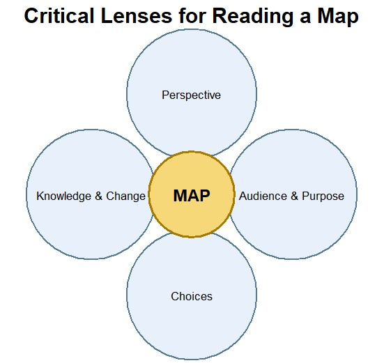

La présente section explique comment lire et analyser les cartes dans le cadre de la recherche historique. Les principes exposés ci-dessous vous guideront tout au long de cette leçon.
<!-- more -->

### En savoir plus sur la méthodologie
<!-- section-contents --> 

En principe, toutes les cartes sont thématiques. Nous pouvons distinguer les cartes qui mettent l’accent sur les caractéristiques topographiques, telles que celles représentant la surface terrestre, et celles qui illustrent des données sociodémographiques, les lignes de transports publics, la criminalité, etc. Toutefois, les principales étapes du processus cartographique s’appliquent à tous les types de cartes :

In principle, all maps are thematic. We can distinguish between maps that focus on topographic features, such as maps of the Earth’s surface, and maps that depict social demographics, public transportation lines, crime, etc. However, the basic steps in the mapping process are relevant for all types of maps:
1. Choisir la projection
2. Définir l’étendue géographique
3. Concevoir la carte
4. Choisir les méthodes de classification et les catégories
5. Choisir les couleurs utilisées pour représenter les données
6. Définir clairement le public cible
7. Ajouter les libellés
8. Ajouter une légende
9. Définir la mise en page
10. Veiller à la hiérarchie visuelle

### Instructions

Comment lire une carte historique ? Compte tenu des aspects exposés ci-dessus, il convient de combiner les principes traditionnels de la critique des sources avec les approches spécifiques inhérentes au processus de création des cartes.

Éléments à prendre en considération : 

1. Perspective
   - Cartographe : qui a créé la carte et où 
   - Champ couvert et échelle : qu’est-ce qui est représenté (une partie du monde, le monde entier, etc.) 
   - Projection

2. Public cible et objectif
   - Utilité de la carte 
   - Argument

3. Choix
   - Ce qui est représenté sur la carte 
   - Ce qui manque
   - La manière dont les éléments sont représentés
 

4. Connaissances et évolutions
   - État des connaissances scientifiques au moment de la création
   - Technologies disponibles pour réaliser la carte

Vous pouvez élaborer votre propre liste de contrôle au fil de cette leçon, en y ajoutant des éléments ou en modifiant le cadre de base présenté ci-dessus. À l’issue de cet exercice, vous aurez constitué votre propre catalogue d’éléments cartographiques.

Fig. 1 Comment interpréter une carte historique. Visualisation créée par Ranke.2 inspirée par les principes exposés dans Michelle LeBlanc, Reading maps: How to analyze a map. 31 octobre 2017 https://web.archive.org/web/20230529030026/https://www.choices.edu/video/reading-maps-analyze-map/  

{:.table.border.table-sm.text-sm.text-bold-highlight}
| 1. PERSPECTIVE | 2. PUBLIC & OBJECTIF | 3. CHOIX | 4. CONNAISSANCES & ÉVOLUTIONS |
|-------------------|--------------------------|----------------|---------------------------|
| Auteur de la carte (qui ? où ?) | Utilité (dans quel but?) | Que montre-t-elle? | État des connaissances scientifiques à l’époque |
| Espace géographique (quelle étendue ?) | Argument (quel message?) | Que manque-t-il ? | Technologies disponibles |
| Projection |  | Comment les informations sont-elles représentées ? |  |

### Example
Si vous souhaitez voir comment les principes exposés ci-dessus sont appliqués à l’analyse de cartes historiques, regardez cette vidéo consacrée à l’analyse d’une carte de l’Afrique datant du XVIIe siècle: Burns Library: « How to Read a Historical Map » [Comment lire une carte historique](https://youtu.be/1jY_6mRIPag), (6 min 06 s).

*NDLR:*
Les principes de la grille d’interprétation ci-dessus s’inspirent de : Michelle LeBlanc, Reading maps: How to analyze a map (Lecture des cartes : comment analyser une carte). 31 octobre 2017. Leçon « Interpreting a Native Map » (Interprétation d’une carte autochtone), collection Choices Program Curriculum Unit, université de Brown. https://web.archive.org/web/20230611015533/https://www.choices.edu/video-playlist/?unit=402.

Ces ressources ne sont plus disponibles depuis que le programme Choices a cessé de bénéficier d’un financement le 30 juin 2025. Par conséquent, depuis la date de clôture du programme, leur contenu n’est plus concédé sous licence, transféré ni maintenu en vue de permettre son accès ou son utilisation en classe.
